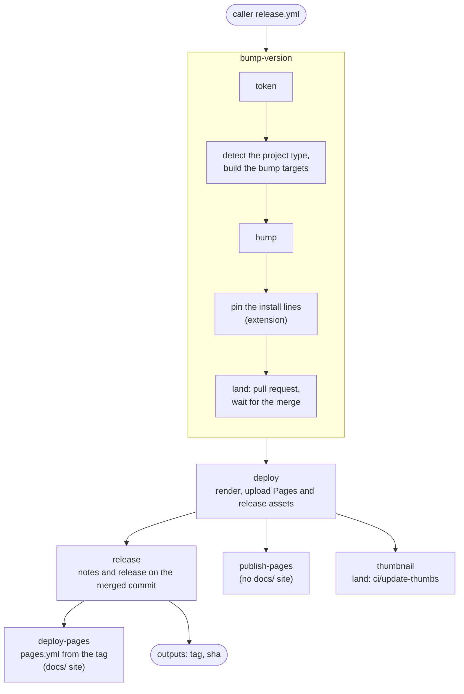

# Quarto Actions Workflows

GitHub Actions workflows for Quarto projects.

## Versioning

Callers pin a tag rather than a branch.
Three tags are published for every release: `vX.Y.Z`, which never moves, and `vX.Y` and `vX`, which roll forward on to each new release they cover.
The examples below pin `vX`, which is the usual choice, since Dependabot's `github-actions` ecosystem updates a `uses:` reference to the next major on its own.
The current major is `v2`.
The body of each release is its section of [`CHANGELOG.md`](CHANGELOG.md), followed by the notes GitHub generates.

A change to a workflow input, or to what a workflow does to the repository calling it, bumps the major.
Everything else is a minor or a patch.

Within a release, the workflows are self-consistent: each one resolves the actions it uses, and the workflows it calls, from the same commit the caller pinned.
That does not extend to the actions maintained elsewhere that these workflows call, `mcanouil/quarto-extensions-updater`, `mcanouil/release-actions` and the `actions/*` family among them, which are themselves pinned to a major and so still move.

## Usage

> [!NOTE]
> All workflows require a GitHub label `Type: CI/CD :robot:` to be available in your repository for automated PR management.

### [`release.yml`](.github/workflows/release.yml)

A unified reusable workflow for releasing Quarto extensions and presentations.
It auto-detects output formats, language runtimes, and project type via `quarto inspect`.

Key features include:

- **Auto-detection**: Output formats, engines (R/Python/Julia), and TinyTeX are detected by the [`setup-quarto-compute`](#setup-quarto-compute) action, shared with `pages.yml`. Slide-to-PDF needs are derived from the detected formats.
- **Repo type detection**: A repo is treated as an extension when it owns the manifest derived from its name (`owner/quarto-<name>` then `_extensions/<name>/_extension.yml`); such repos use semantic versioning. Every other repo is a project and uses date-based versioning, so a project that merely installs extensions as dependencies is not mistaken for one. Set the `repo-type` input to `extension` or `project` to override the detection.
- **Project directory detection**: Renders from `docs/` when `docs/_quarto.yml` exists, otherwise from the repository root.
  With a `docs/` site, or a render list in `_quarto.yml`, the root render also skips `test/` or `tests/` when they hold a Quarto project of their own.
- **Quarto project type**: The project type and output directory are read from `quarto inspect`, so `website` and `book` projects (and any custom `output-dir`) are deployed from the directory Quarto reports. Non-default projects render as a whole project, while default projects render each detected format individually.
- **Extension assets**: Packages `_extensions/` as `{name}-v{version}.tar.gz` and `.zip` release assets.
- **Multi-format rendering**: Renders each detected format individually via `quarto render --to`.
- **Slide-to-PDF conversion**: Automatic PDF generation using DeckTape for custom Reveal.js format extensions and presentations.
- **GitHub integration**: Creates PRs for version bumps, deploys to GitHub Pages, and publishes releases with assets and install instructions.
- **Version bump and release**: [`mcanouil/release-actions`](https://github.com/mcanouil/release-actions) bumps the version, rolls `CHANGELOG.md`, composes the release body from the changelog section and the generated notes, and creates the release.
  An empty `## Unreleased` section, or no `CHANGELOG.md`, releases without a changelog section.
  An existing tag or release stops the run before the version bump is pushed.
- **Bump before render**: The workflow waits for the version bump pull request to merge, then renders and tags the exact commit it merged as, so the tag always carries the bumped manifest.
- **Read-only render**: The job that renders the released project holds no write scope, and the template thumbnail it produces is committed back by a separate job.
- **Safe repeat**: If a run lands the version bump and then fails, the next run stops and says which release to create by hand.

The jobs run in this order:



The bump writes these files with the [`ecosystems`](https://github.com/mcanouil/release-actions#ecosystems) presets of `release-actions`: `quarto-extension, citation` for an extension, and `citation` for a project.
Both repo types record the release version and date in `CITATION.cff`, so the file is required.
It needs a line `version: X.Y.Z` and a line `date-released: "YYYY-MM-DD"`.
The bump keeps the form of each value, with or without quotes.
A project can start from any date, such as `version: 2026.01.01`.
An extension also needs `version: X.Y.Z` in its `_extension.yml`, on a line of its own, without quotes or a comment.
The extension must have exactly one manifest one level under `_extensions/`.
Detection, and `repo-type: extension` too, looks for it at `_extensions/<name>/_extension.yml`, where `<name>` is the repository name without `quarto-`, or also without `revealjs-`.
As it is the only manifest at that level, the bump writes the same file.
The bump does not change the vendored extensions under `_extensions/<owner>/<name>/`.
The release stops before the version bump when one of these lines is missing or written another way.

#### Inputs

| Input           | Default     | Description                                                                                     |
| --------------- | ----------- | ----------------------------------------------------------------------------------------------- |
| `version`       | `"minor"`   | Version bump type (`patch`/`minor`/`major`). Used for extensions only; ignored for projects.    |
| `repo-type`     | `"auto"`    | Repo type (`auto`/`extension`/`project`). `auto` detects from the repo name and owned manifest. |
| `quarto`        | `"release"` | Quarto version to install (`release` or `pre-release`).                                         |
| `gh-app-id`     |             | GitHub App ID for authentication (optional). Falls back to the `APP_ID` repository variable.    |
| `merge-timeout` | `1800`      | Seconds to wait for the version bump pull request to merge.                                     |
| `notes-header`  | `""`        | Template file in the caller, put first in the release body. Default: the install header for an extension, none for a project. |
| `pin-files`     | `""`        | Files in the caller whose pins of the repository follow the release, separated by spaces or new lines. Extensions only. |

#### Outputs

| Output | Description |
| --- | --- |
| `tag` | Tag of the release. |
| `sha` | Commit of the release, which is the merged version bump. |

A later job of the caller can use them, for example to attach more files to the release:

```yaml
  attach:
    needs: release
    runs-on: ubuntu-latest
    permissions:
      contents: write
    steps:
      - uses: actions/checkout@v7
        with:
          ref: ${{ needs.release.outputs.sha }}
      - env:
          GH_TOKEN: ${{ github.token }}
          TAG: ${{ needs.release.outputs.tag }}
        run: gh release upload "${TAG}" dist/*
```

The `notes-header` template can contain `{version}`, `{tag}`, `{date}` and `{repository}`.

The `pin-files` input is for references the install files don't cover, such as a workflow that uses the repository's own actions.
The bump rewrites every `<repository>@X.Y.Z` and `<repository>/<path>@X.Y.Z` pin in those files to the released version, and lands them with the rest of the bump.
Each file must exist and hold at least one such pin, or the release stops before the bump.
GitHub refuses a push that changes a file under `.github/workflows/` unless the token can write workflows, so a GitHub App needs the Workflows permission, and a personal access token needs the `workflow` scope.

#### Authentication

A GitHub App is optional.
Each job that writes resolves its own token through the [`token`](https://github.com/mcanouil/release-actions#token) action of `release-actions` and uses it for every `gh` call, and for the checkout it pushes from, so the version bump, the thumbnail update, and the release are attributed to whichever identity was resolved.

| Configuration                                        | Token                              | Identity              |
| ---------------------------------------------------- | ---------------------------------- | --------------------- |
| `gh-app-id` (or the `APP_ID` variable) and `APP_KEY` | GitHub App installation token      | `<app-slug>[bot]`     |
| `GH_TOKEN` secret                                    | The personal access token supplied | The token's owner     |
| Neither                                              | The default `GITHUB_TOKEN`         | `github-actions[bot]` |

Secrets reach the workflow through `secrets: inherit`.
An App id supplied without `APP_KEY` emits a warning and falls back rather than failing, so a repository that inherits the `APP_ID` variable without the matching secret still releases.

Scopes are declared per job rather than once for the workflow, so only the three jobs that write hold a token that can.

| Job             | Permissions                                         | What it writes                                   |
| --------------- | --------------------------------------------------- | ------------------------------------------------ |
| `bump-version`  | `contents: write`, `pull-requests: write`           | The version bump branch and its pull request.    |
| `deploy`        | `contents: read`, `pages: write`                    | Nothing; it renders, packages, and stages Pages. |
| `thumbnail`     | `contents: write`, `pull-requests: write`           | `.github/template.png`, through a pull request.  |
| `publish-pages` | `contents: read`, `pages: write`, `id-token: write` | The Pages deployment, where there is no `docs/`. |
| `release`       | `contents: write`                                   | The tag and the GitHub release.                  |
| `deploy-pages`  | `contents: read`, `pages: write`, `id-token: write` | The Pages deployment, where there is a `docs/`.  |

The calling job still grants the union of these, since a called workflow can only narrow what it was given.

The render job takes no App token at all, and drops the credentials the checkout left in `.git/config` before it restores dependencies and renders, since everything from that point runs code the released project controls.
A project that resolves a private GitHub dependency from `renv.lock`, `pyproject.toml`, or `Project.toml` therefore has to carry its own credentials for it rather than borrow the release token.
The template thumbnail a deck renders is handed to the `thumbnail` job as an artifact, which resolves its own token and opens the pull request.
That job is allowed to fail: the tag, the release, and the deployment do not wait on it.

Two limitations apply to the `GITHUB_TOKEN` path only.

- A push made with `GITHUB_TOKEN` triggers no workflow, so the version bump pull request receives no checks. Where the default branch requires status checks, `gh pr merge --auto` then never completes. The release fails rather than tagging a commit that was never bumped, and says so within a couple of minutes: a pull request that is blocked with no check of any kind reported against it is waiting for something that cannot arrive. Configure a GitHub App, or supply a `GH_TOKEN` personal access token. A branch that requires a review as well is left to `merge-timeout`, since that block is a person rather than a configuration.
- Creating the version bump pull request needs the repository setting "Allow GitHub Actions to create and approve pull requests", under Settings, Actions, General. Without it `gh pr create` fails.

#### Example

A reusable workflow cannot raise the caller's token, so the calling job grants the write scopes the release needs.
Everything else in the calling workflow stays read-only.

```yaml
name: Release

on:
  workflow_dispatch:
    inputs:
      version:
        type: choice
        description: "Version"
        default: "minor"
        options:
          - "patch"
          - "minor"
          - "major"
      quarto:
        type: choice
        description: "Quarto version"
        default: "release"
        options:
          - "release"
          - "pre-release"

permissions:
  contents: read

jobs:
  release:
    uses: mcanouil/quarto-workflows/.github/workflows/release.yml@v2
    permissions:
      contents: write
      pull-requests: write
      pages: write
      id-token: write
    secrets: inherit
    with:
      gh-app-id: ${{ vars.APP_ID }}
      version: ${{ inputs.version }}
      quarto: ${{ inputs.quarto }}
```

The `version` input is only relevant for extension repos, meaning repos that own a matching `_extensions/<name>/_extension.yml`.
A project ignores it and uses date-based versioning taken from `CITATION.cff`, so its caller drops both the `version` dispatch input and the `version:` line under `with:`.

### [`pages.yml`](.github/workflows/pages.yml)

A reusable workflow that renders the documentation website under `docs/`, or the Quarto project named by `path`, and deploys it to GitHub Pages.
The Release workflow calls it after tagging, so the published site describes the version users can install.
It is also dispatchable on its own, and a pull request that calls it renders the site as a check without deploying.

A draft pull request renders nothing.
The render is what installs R, Python, Julia, TinyTeX, and the Chrome libraries the site needs, and a draft is not asking for that yet.
A caller triggered by `pull_request` therefore has to list `ready_for_review` among its `types`, since the default set of `opened`, `synchronize`, and `reopened` fires nothing when a pull request leaves draft, and the render would otherwise wait for a further push.

Key features include:

- **Released source by default**: The latest version tag is resolved and rendered, unless `ref` or `use-main-as-release` says otherwise. Pull requests always render their own head.
- **Shallow clone**: The whole history is fetched only when the latest version tag is resolved; every other run takes a shallow clone.
- **Drafts skipped**: A draft pull request skips the render, and marking it ready for review runs it.
- **Extension mirror**: `<path>/_scripts/sync-extension.sh` is run when present, so a shortcode contributed by the repository's own extension is on disk before Quarto builds its extension registry.
- **Compute environment**: R, Python, Julia, TinyTeX, and Chrome libraries are installed from what [`setup-quarto-compute`](#setup-quarto-compute) detects, so pages that execute code render.
- **Single deployment at a time**: Pages runs queue rather than cancel; pull request renders get a per-ref concurrency group and run in parallel. A caller sets no `concurrency` of its own, since a group shared with this workflow would block it.

#### Inputs

| Input                 | Default     | Description                                                       |
| --------------------- | ----------- | ----------------------------------------------------------------- |
| `ref`                 | `""`        | Commit or ref to build. Defaults to the latest version tag.       |
| `use-main-as-release` | `false`     | Render from the triggering ref instead of the latest version tag. |
| `quarto`              | `"release"` | Quarto version to install (`release` or `pre-release`).           |
| `path`                | `"docs"`    | Quarto project directory to render and deploy; `.` is the root.   |

#### Example

```yaml
name: Pages

on:
  pull_request:
    # The render is skipped while the pull request is a draft, and
    # `ready_for_review` is what runs it once the draft is lifted.
    types: [opened, synchronize, reopened, ready_for_review]
    paths:
      - "docs/**"
      - "_extensions/**"
      - "CHANGELOG.md"
      - ".github/workflows/pages.yml"
  workflow_dispatch:
    inputs:
      use-main-as-release:
        type: boolean
        description: "Render from the default branch instead of the latest version tag"
        default: false
      quarto:
        type: choice
        description: "Quarto version"
        default: "release"
        options:
          - "release"
          - "pre-release"

permissions:
  contents: read

jobs:
  pages:
    uses: mcanouil/quarto-workflows/.github/workflows/pages.yml@v2
    permissions:
      contents: read
      pages: write
      id-token: write
    with:
      use-main-as-release: ${{ inputs.use-main-as-release || false }}
      quarto: ${{ inputs.quarto || 'release' }}
```

### [`quarto-extensions-updates.yml`](.github/workflows/quarto-extensions-updates.yml)

A reusable workflow that checks the Quarto extensions a repository installs for newer releases and opens a grouped pull request for whatever it finds, through [`quarto-extensions-updater`](https://github.com/mcanouil/quarto-extensions-updater).
It runs monthly for this repository, and is dispatchable on its own.

The repository root is always scanned.
An extension repository passes `scan-directories: docs`, because its documentation website keeps its own dependencies under `docs/_extensions/`.
The resulting pull request carries the `Type: Dependencies :arrow_up:` label, which the repository has to define.

#### Inputs

| Input              | Default   | Description                                                                                  |
| ------------------ | --------- | -------------------------------------------------------------------------------------------- |
| `scan-directories` | `""`      | Newline-separated directories to scan, in addition to the repository root.                   |
| `gh-app-id`        |           | GitHub App ID for authentication (optional). Falls back to the `APP_ID` repository variable. |
| `quarto-version`   | `release` | Quarto version to install: `release`, `pre-release`, or a version number.                    |

The token is resolved by the `token` action of `release-actions`, on the same terms as the Release workflow.

#### Example

```yaml
name: Quarto Extensions Updates

on:
  workflow_dispatch:
  schedule:
    - cron: "00 12 1 * *"

permissions:
  contents: read

jobs:
  update:
    uses: mcanouil/quarto-workflows/.github/workflows/quarto-extensions-updates.yml@v2
    permissions:
      contents: write
      pull-requests: write
    secrets: inherit
    with:
      gh-app-id: ${{ vars.APP_ID }}
      scan-directories: docs
```

## Actions

The workflows above check this action out from their own commit and run it from the workspace, so a caller that pinned a workflow to a release gets the action that shipped with it.
It is not meant to be called directly.

### [`setup-quarto-compute`](.github/actions/setup-quarto-compute/action.yml)

A composite action that reads what a Quarto project needs from `quarto inspect`, then installs only that.
It is used by both `release.yml` and `pages.yml`, and expects Quarto to be installed already, along with any extension the project resolves.

Engines come from the project-level inspection, so `.qmd`, `.ipynb`, and `.md` inputs all count.
Formats are derived from that same inspection rather than from a pass over every input, since a project inspection reports engines but no resolved formats.
They are collected from the project configuration, the front matter of each `.qmd` input, and the `_metadata.yml` files above it, which is where Quarto itself reads them from.
Reading those `_metadata.yml` files needs `yq`, which the GitHub-hosted runners provide.
Dependency manifests are looked up in the project directory first and the repository root second, which is how a `docs/` website renders with a `pyproject.toml` or `renv.lock` kept at the root.

Only `.qmd` inputs contribute their front matter, since a `.md` would add a spurious `html`.
A format declared in the front matter of an `.ipynb` is therefore not detected: set it in the project configuration or in a `_metadata.yml` instead.

A Python environment is left activated by `uv`, so later steps render with it without sourcing anything.
Inspection does not run pre-render scripts, so a document generated by one is invisible to detection: an engine used only by a generated document has to be present in a committed document as well.
The detected formats and engines are written to the job summary by the action itself, so callers do not repeat them.

#### Inputs

| Input      | Default  | Description                                                                                                |
| ---------- | -------- | ---------------------------------------------------------------------------------------------------------- |
| `path`     | `"."`    | Quarto project directory or single document to inspect.                                                    |
| `chromium` | `"auto"` | Install Chrome libraries: `auto` only when a LaTeX-bound format is detected, `true` always, `false` never. |

#### Outputs

| Output         | Description                                                           |
| -------------- | --------------------------------------------------------------------- |
| `formats`      | Space-separated output formats detected across the project.           |
| `engines`      | Space-separated engines detected across the project.                  |
| `need-r`       | Whether the `knitr` engine is used.                                   |
| `need-python`  | Whether the `jupyter` engine is used.                                 |
| `need-julia`   | Whether the `julia` engine is used.                                   |
| `need-tinytex` | Whether a LaTeX-bound format is produced (Typst does not count).      |
| `input-files`  | Newline-separated input files the project renders, as absolute paths. |

#### Installed per detection

| Detected                        | Installed                                                                                                                                                                         |
| ------------------------------- | --------------------------------------------------------------------------------------------------------------------------------------------------------------------------------- |
| `knitr`                         | R (public RSPM binaries), then `renv` when a `renv.lock` is found, otherwise a cached `knitr` and `rmarkdown`.                                                                    |
| `jupyter`                       | `uv`, with the interpreter it resolves from `requires-python`, then `uv sync` when a `pyproject.toml` is found, otherwise a bootstrap environment with `jupyter` and `papermill`. |
| `julia`                         | Julia and a package cache, then `Pkg.instantiate()` and `IJulia`.                                                                                                                 |
| `pdf`, `beamer`, `latex` format | TinyTeX, cached across runs and put on `PATH`, and the Chrome libraries Quarto needs to turn diagrams into images.                                                                |

#### Tests

[`test-setup-quarto-compute.yml`](.github/workflows/test-setup-quarto-compute.yml) runs the action against the fixtures under [`tests/`](tests), one per install path: `knitr` with a `renv.lock`, `jupyter` with and without a `pyproject.toml`, `julia`, a PDF format, and a Reveal.js deck converted with DeckTape as the release workflow does.
Each fixture asserts what detection reported, checks that the toolchain it installed is usable, and renders.
It runs on pull requests touching the action, its fixtures, or the slides script, on dispatch, and monthly, and skips a pull request that is still a draft.
